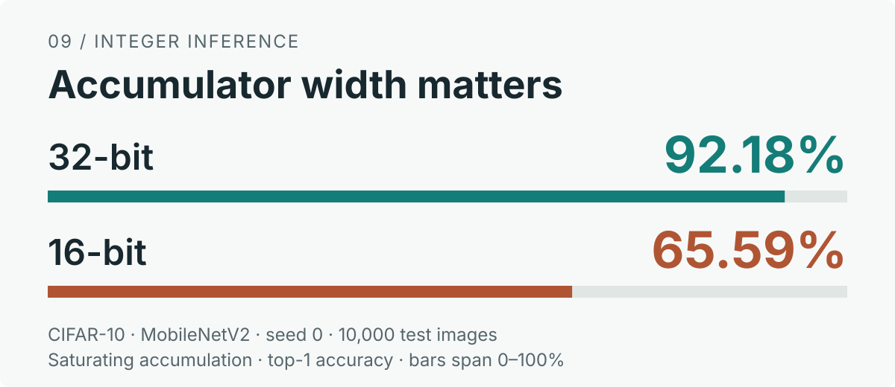

# quant-pitfalls

**작은 실험으로 배우는 신경망 양자화의 함정 9가지.**

클리핑·반올림부터 PTQ, QAT, 정수 누산기까지, 조건 하나가 오차와 정확도를 어떻게 바꾸는지 비교하는 교육용 PyTorch 프로젝트다. PyTorch로 모델을 학습해 본 독자를 대상으로 한다.

[실습 시작](#빠르게-시작하기) · [9개 노트북](#무엇을-배우나요) · [학습 가이드](docs/README.md) · [재현 방법](docs/reproduction.md)

<p align="center">
  <a href="notebooks/09_accumulator-saturation.ipynb">
    
  </a>
</p>

**같은 가중치, 다른 누산기.** CIFAR-10 + MobileNetV2의 같은 W4A8 체크포인트에서 포화 누산기 폭을 바꾸자 top-1이 **32비트 92.18%에서 16비트 65.59%로 달라졌다.** 시드 0, 테스트 10,000장의 저장된 측정값이며 FP32 fake-quant는 92.14%였다. [노트북 09](notebooks/09_accumulator-saturation.ipynb)에서 정수 연산 규칙과 오버플로를 살펴본다. 구현은 정확도와 오버플로를 관찰하는 수치 시뮬레이터다.

## 빠르게 시작하기

Python 3.10 이상과 uv를 사용한다. 저장소 루트에서 실행한다.

```bash
uv sync --frozen --all-groups
bash scripts/reproduce.sh --from-results
```

**데이터셋·체크포인트 없이 CPU로 시작할 수 있다.** 테스트와 노트북 9개를 실행해 실험 SVG 14개와 결과 표를 만든다. 수학·합성 실험은 다시 계산하고, 학습 곡선과 정확도 표는 저장소에 포함된 측정 기록으로 그린다. 새 모델 학습과 체크포인트 재평가의 조건은 [재현 방법](docs/reproduction.md)을 참고한다.

직접 코드를 바꾸며 실습하려면 다음 명령으로 노트북을 연다.

```bash
uv run jupyter lab notebooks/
```

## 무엇을 배우나요?

**오차의 기초 → 관측·BN 상태 → 학습·정수 추론** 순서로 읽으면 좋다. 각 노트북의 ‘직접 확인하기’에서 고정 조건을 유지하며 변수 하나씩 바꿔 본다.

| 노트북 | 핵심 질문 |
|---|---|
| [01 · 클리핑 MSE](notebooks/01_clipping-mse.ipynb) | min/max 범위가 왜 최적이 아닐까? |
| [02 · floor 반올림](notebooks/02_floor-rounding.ipynb) | 반올림이 오차의 평균·분산을 어떻게 바꿀까? |
| [03 · APoT와 균일 양자화](notebooks/03_apot-vs-uniform.ipynb) | 같은 레벨 수에서도 분포에 따라 승패가 바뀔까? |
| [04 · BN 접기](notebooks/04_bn-folding.ipynb) | 양자화와 BN 접기의 순서가 왜 중요할까? |
| [05 · 관측 워밍업](notebooks/05_observe-before-quant.ipynb) | 충분히 관측하기 전에 양자화를 켜면? |
| [06 · 가중치 저장 정밀도](notebooks/06_fp16-master-weights.ipynb) | 작은 업데이트는 언제 FP16에서 사라질까? |
| [07 · QAT의 BN 통계](notebooks/07_bn-stats-in-qat.ipynb) | BN 동결 시점과 배치 크기는 어떤 관계일까? |
| [08 · PTQ·QAT·KD](notebooks/08_ptq-vs-qat.ipynb) | 단계별 양자화와 지식 증류가 도움이 될까? |
| [09 · 누산기 포화](notebooks/09_accumulator-saturation.ipynb) | 누산기 폭만 바꿔도 정확도가 달라질까? |

추천 경로: **01–03 → 04·05·07 → 06·08·09**. 설명과 수식은 [학습 가이드](docs/README.md), 각 수치의 출처는 [수치 근거](docs/evidence.md)에서 확인한다.

## 기록된 결과

CIFAR-10 + MobileNetV2에서 같은 시드의 float 체크포인트를 사용했다. 아래는 시드 0·1·2의 최고 평가 top-1 평균 ± 표본 표준편차다.

| 설정 | top-1 (%) |
|---|---|
| Float | 92.40 ± 0.12 |
| W4A8 단계별 QAT | 92.22 ± 0.07 |
| W4A8 단계별 QAT + KD | 92.28 ± 0.21 |

[전체 비교 표](docs/README.md#6-종단-실험-cifar-10--mobilenetv2)는 PTQ 클리핑, 양자화 스케줄, APoT 대조군을 포함한다. 국소 MSE 개선이 분류 정확도 개선으로 이어지지 않은 사례도 함께 다룬다.

## 코드 살펴보기

- `src/quant_pitfalls/quant/`: 반올림, 양자화기, observer, fake-quant
- `src/quant_pitfalls/layers/`, `convert.py`, `training.py`: BN 접기, QAT 변환·스케줄, 학습
- `src/quant_pitfalls/sim/`: 정수 누산·재양자화·모델 평가
- `tests/`: 수학적 기대값과 경계·상태·기록 검증
- `docs/results/`: 재현 가능한 학습 측정 기록과 SHA-256

```bash
uv run pytest -q
uv run python train.py --help
```

## 더 읽기와 기여

[재현 방법](docs/reproduction.md) · [수치 근거](docs/evidence.md) · [참고문헌](docs/references.md) · [기여 가이드](CONTRIBUTING.md)

코드는 [MIT 라이선스](LICENSE)로 제공한다. CIFAR-10의 출처·인용·라이선스 확인 상태는 [데이터셋 문서](docs/datasets.md)를 따른다.
