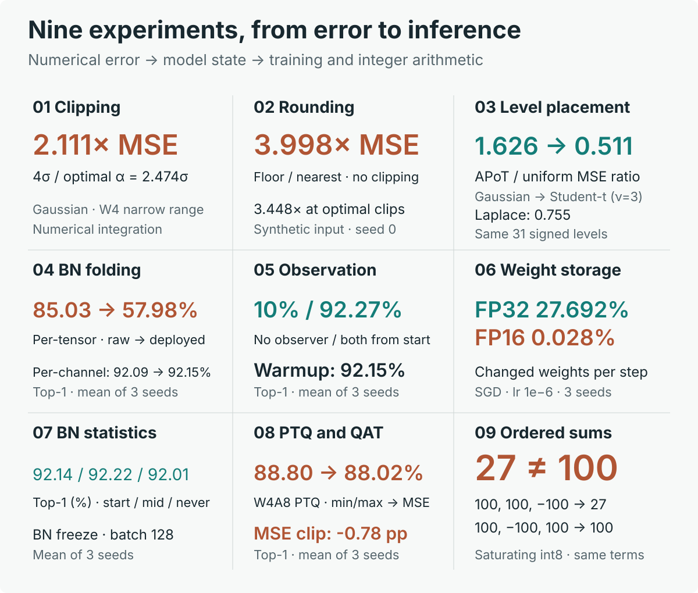
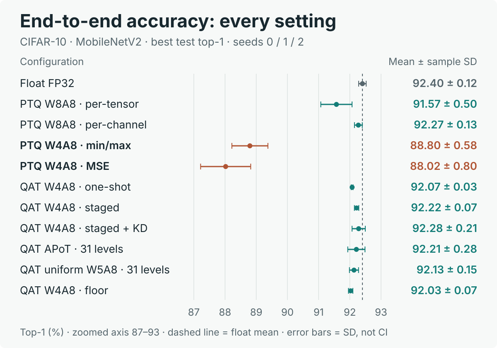

# quant-pitfalls

**작은 실험으로 배우는 신경망 양자화의 함정 9가지.**

클리핑·반올림부터 PTQ, QAT, 정수 누산기까지, 조건 하나가 오차와 정확도를 어떻게 바꾸는지 비교하는 교육용 PyTorch 프로젝트다. PyTorch로 모델을 학습해 본 독자를 대상으로 한다.

[실습 시작](#빠르게-시작하기) · [9개 실험 결과](#무엇을-배우나요) · [전체 정확도 비교](#기록된-결과) · [학습 가이드](docs/README.md)

<p align="center">
  <a href="docs/figures/readme/experiment-overview.svg">
    
  </a>
</p>

01–03은 수학·합성 입력 실험, 04–08은 CIFAR-10 + MobileNetV2의 세 시드 측정, 09는 포화 덧셈의 작은 예제다. 서로 다른 지표를 사용하므로 각 칸의 조건과 단위를 함께 읽는다.

- **국소 오차와 모델 정확도는 다르다.** W4A8 PTQ에서 MSE 클립의 top-1은 88.02%, min/max는 88.80%였다. 이번 측정에서는 MSE 클립이 0.78 pp 낮았다.
- **양자화기의 유불리는 분포에 달려 있다.** 같은 31레벨에서도 APoT/균일 MSE 비는 Gaussian 1.626, Laplace 0.755, Student-t 0.511로 뒤집혔다.
- **배포 때 바뀌는 연산 순서가 중요하다.** raw 가중치를 per-tensor로 양자화한 모델은 BN 접기·재양자화 후 85.03% → 57.98%로 떨어졌다. per-channel에서는 92.09% → 92.15%였다.

## 빠르게 시작하기

Python 3.10 이상과 uv를 사용한다. 저장소 루트에서 실행한다.

```bash
uv sync --frozen --all-groups
bash scripts/reproduce.sh --from-results
```

**데이터셋·체크포인트 없이 CPU로 시작할 수 있다.** 테스트와 노트북 9개를 실행해 실험 SVG 14개와 결과 표를 만든다. 수학·합성 실험은 다시 계산하고, 학습 곡선과 정확도 표는 저장소에 포함된 측정 기록으로 그린다. 새 모델 학습과 체크포인트 재평가의 조건은 [재현 방법](docs/reproduction.md)을 참고한다.

직접 코드를 바꾸며 실습하려면 다음 명령으로 노트북을 연다.

```bash
uv run jupyter lab notebooks/
```

## 무엇을 배우나요?

**오차의 기초 → 관측·BN 상태 → 학습·정수 추론** 순서로 읽으면 좋다. 각 노트북의 ‘직접 확인하기’에서 고정 조건을 유지하며 변수 하나씩 바꿔 본다.

| 노트북 | 이번 실험에서 관찰한 결과 |
|---|---|
| [01 · 클리핑 MSE](notebooks/01_clipping-mse.ipynb) | Gaussian W4의 최적 α는 2.474σ. 고정 4σ의 MSE는 최적 대비 2.111배였다. |
| [02 · floor 반올림](notebooks/02_floor-rounding.ipynb) | floor/nearest MSE 비는 클리핑 없이 3.998, Gaussian W8에서 각자 최적 클립을 쓰면 3.448이었다. |
| [03 · APoT와 균일 양자화](notebooks/03_apot-vs-uniform.ipynb) | 같은 31레벨의 APoT/균일 MSE 비: Gaussian 1.626, Laplace 0.755, Student-t(ν=3) 0.511. |
| [04 · BN 접기](notebooks/04_bn-folding.ipynb) | raw → 배포 top-1: per-tensor 85.03 → 57.98%, per-channel 92.09 → 92.15% (시드 3개 평균). |
| [05 · 관측 워밍업](notebooks/05_observe-before-quant.ipynb) | 초기 보정 없이 관측을 끄면 10.00%, 관측·양자화를 함께 켜면 92.27%, 워밍업은 92.15% (최고 top-1, 시드 3개 평균). |
| [06 · 가중치 저장 정밀도](notebooks/06_fp16-master-weights.ipynb) | SGD·lr=10⁻⁶에서 스텝당 가중치 변경률은 FP32 27.692%, FP16 0.028%. 한 epoch의 스텝 평균을 시드 3개로 평균했다. |
| [07 · QAT의 BN 통계](notebooks/07_bn-stats-in-qat.ipynb) | 배치 128에서 처음·중간·미동결의 최고 top-1은 92.14·92.22·92.01% (시드 3개 평균). 미동결의 붕괴는 이 조건에서 관찰되지 않았다. |
| [08 · PTQ·QAT·KD](notebooks/08_ptq-vs-qat.ipynb) | W4A8 PTQ min/max 88.80%, MSE 88.02%; 단계별 QAT 92.22%, +KD 92.28% (시드 3개 평균). 아래에서 11개 설정을 모두 비교한다. |
| [09 · 누산기 포화](notebooks/09_accumulator-saturation.ipynb) | int8 포화 누산: [100, 100, −100] → 27, [100, −100, 100] → 100. 같은 항도 순서에 따라 결과가 달라지고, wrap은 둘 다 100이다. |

추천 경로: **01–03 → 04·05·07 → 06·08·09**. 설명과 수식은 [학습 가이드](docs/README.md), 각 수치의 출처는 [수치 근거](docs/evidence.md)에서 확인한다.

## 기록된 결과

CIFAR-10 + MobileNetV2의 **11개 종단 설정 전체**다. PTQ·QAT는 같은 시드의 float 체크포인트에서 시작했다. 점은 시드 0·1·2의 최고 평가 top-1 평균, 오차 막대는 표본 표준편차다. 가로축은 87–93%로 확대했다.

<p align="center">
  <a href="docs/figures/readme/end-to-end-accuracy.svg">
    
  </a>
</p>

<details>
<summary>전체 수치 표 펼치기 — 평균 ± 표본 표준편차, 각 n=3</summary>

| 설정 | top-1 (%) |
|---|---|
| Float FP32 | 92.40 ± 0.12 |
| W8A8 PTQ · per-tensor | 91.57 ± 0.50 |
| W8A8 PTQ · per-channel | 92.27 ± 0.13 |
| W4A8 PTQ · per-channel · min/max | 88.80 ± 0.58 |
| W4A8 PTQ · per-channel · MSE | 88.02 ± 0.80 |
| W4A8 한 번에 QAT | 92.07 ± 0.03 |
| W4A8 단계별 QAT | 92.22 ± 0.07 |
| W4A8 단계별 QAT + KD | 92.28 ± 0.21 |
| APoT QAT · 부호 포함 31레벨 | 92.21 ± 0.28 |
| 균일 W5A8 QAT · 31레벨 대조군 | 92.13 ± 0.15 |
| W4A8 단계별 QAT · floor 활성화 | 92.03 ± 0.07 |

</details>

APoT는 크기 4비트에 부호가 추가된 31레벨이므로 균일 W5의 31레벨과 비교한다. 시드 3개의 표준편차는 신뢰구간이 아니며, 작은 평균 차이만으로 보편적인 우열을 단정하지 않는다. 레시피·양자화 경계·시드별 float 대비 차이는 [전체 실험 조건](docs/README.md#6-종단-실험-cifar-10--mobilenetv2)에 있다.

정수 모델의 누산 폭·포화·wrap sweep과 전체 테스트 10,000장 결과는 [노트북 09](notebooks/09_accumulator-saturation.ipynb)에서 이어진다. 이 경로는 정확도와 오버플로를 관찰하는 수치 시뮬레이터다.

두 README 그림은 [공개 수치 기록](docs/results/manifest.json)에서 생성한다. 새 학습 없이 다시 그리거나 기록과의 일치를 확인할 수 있다.

```bash
uv run python scripts/render_readme_figures.py
uv run python scripts/render_readme_figures.py --check
```

## 코드 살펴보기

- `src/quant_pitfalls/quant/`: 반올림, 양자화기, observer, fake-quant
- `src/quant_pitfalls/layers/`, `convert.py`, `training.py`: BN 접기, QAT 변환·스케줄, 학습
- `src/quant_pitfalls/sim/`: 정수 누산·재양자화·모델 평가
- `tests/`: 수학적 기대값과 경계·상태·기록 검증
- `docs/results/`: 재현 가능한 학습 측정 기록과 SHA-256

```bash
uv run pytest -q
uv run python train.py --help
```

## 더 읽기와 기여

[재현 방법](docs/reproduction.md) · [수치 근거](docs/evidence.md) · [참고문헌](docs/references.md) · [기여 가이드](CONTRIBUTING.md)

코드는 [MIT 라이선스](LICENSE)로 제공한다. CIFAR-10의 출처·인용·라이선스 확인 상태는 [데이터셋 문서](docs/datasets.md)를 따른다.
